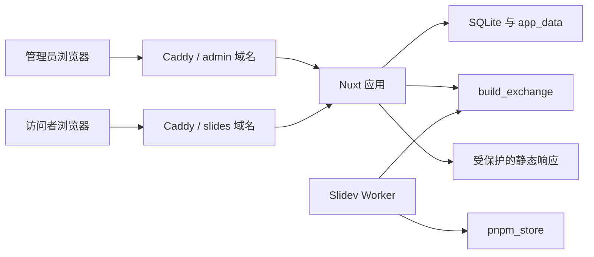

# Slidev Vault 1.0 架构

## 上下文与边界

系统有两类浏览器参与者：唯一管理员和持有展示密码的访问者。外部依赖只有 npm Registry、DNS/ACME 服务和服务器上的 Docker Engine。



## 容器职责

| 容器 | 职责 | 可访问数据 |
|---|---|---|
| Caddy | TLS、压缩、反向代理、访问日志 | 无应用数据 |
| App | 管理 UI、鉴权、上传、SQLite、队列协调、发布与文件响应 | `app_data`、`build_exchange` |
| Worker | 安装项目依赖、执行 Slidev 构建、写构建结果 | `build_exchange`、`pnpm_store` |

Worker 不挂载 `app_data`，因此构建代码看不到密码哈希、会话、其他历史源项目和已发布目录。App 不执行上传项目中的 JavaScript。

## 构建状态机

```text
pending → building → ready
                   ↘ failed
```

1. App 将上传内容保存为不可变 revision，并写入 SQLite。
2. App 复制当前 revision 到独立交换任务目录，最后原子写入 `request.json`。
3. Worker 原子重命名清单以认领任务，写 `status.json` 并构建。
4. Worker 最后原子写入 `result.json`。
5. App 验证输出存在 `index.html`，复制到同一数据卷的临时目录，再原子切换活动 revision。
6. 任何失败都不会改变 `active_revision_id`，上一版继续在线。

## 数据所有权

- `auth_credentials`：密码哈希与全局凭据版本。
- `auth_sessions`：服务端会话，仅保存 Token 的 SHA-256 摘要。
- `decks`：稳定 slug 和当前活动 revision。
- `deck_revisions`：不可变上传版本及构建状态。
- `build_jobs`：队列与运维状态。
- `audit_events`：登录、密码变更、上传、删除等安全事件。

SQLite 启用 WAL、外键、busy timeout 和 normal synchronous。单实例 App 是 1.0 的明确约束；扩展为多 App 实例时，应先迁移 PostgreSQL 和分布式 Session。

## 关键决策

### ADR-001：上传后静态构建

选择预构建静态 SPA，而不是为每份幻灯片保持 Slidev 开发服务器。代价是上传后需要等待构建，收益是稳定资源占用、简单访问控制和可回滚发布。

### ADR-002：展示域与管理域分离

自定义 Vue 组件会在访问者浏览器中执行。管理 Cookie 是管理域名的 Host-only Cookie；展示内容无法读取或携带它访问管理 API，管理写操作还会校验 Origin。

### ADR-003：双卷构建交换区

Worker 不直接读取 SQLite。相较“Worker 共享整个数据卷”，文件交换多了一次复制，但消除了构建代码读取数据库与历史内容的路径。
